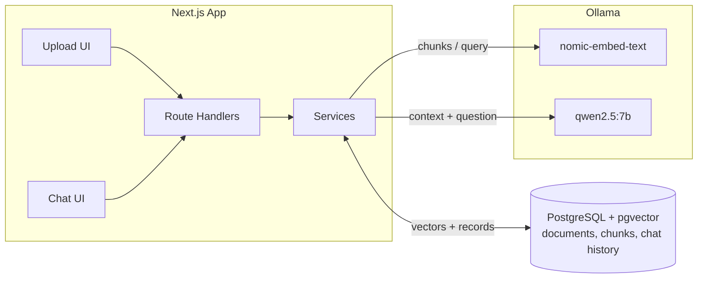

# Local AI Document Assistant

Chat with your documents using Retrieval-Augmented Generation (RAG). Everything runs locally: no OpenAI, no cloud, and your files never leave your machine.

Upload PDFs, Word files, or text files, then ask questions. DocMind finds the relevant passages and answers with citations that point back to the source page.

---

## Features

- Upload PDF, DOCX, TXT, and Markdown files
- Automatic chunking and embedding into a vector database
- Chat that answers from your documents only, with source citations (file + page)
- Says "I don't know" when the answer isn't in the documents, instead of making it up
- Follow-up questions use the previous question for better retrieval
- Multiple collections (e.g. "HR Policies", "Contracts") so you can scope the search
- Delete or re-index documents
- 100% local: Ollama for the LLM and embeddings, PostgreSQL + pgvector for vectors

---

## Architecture

Full diagrams (system overview, ingest and chat sequences, code layers, database schema, document lifecycle) are in [docs/architecture.md](docs/architecture.md).



### Ingest pipeline
1. File is uploaded and saved to `storage/uploads`
2. Text is extracted per page (`unpdf` for PDF, `mammoth` for DOCX)
3. Text is split into chunks (recursive splitter, ~800 tokens, ~100 overlap)
4. Each chunk keeps its `page` and `collection`
5. Embeddings are generated with `nomic-embed-text`
6. Chunks and vectors are stored in pgvector, and the document is marked `ready`

Ingestion runs in the background after the upload response, so the UI shows a live status.

### Chat pipeline
1. The question is embedded and matched against the collection (top-k = 5, cosine similarity)
2. Chunks below the similarity threshold are dropped; if none remain, the answer is "I don't know"
3. The prompt forces answers from the retrieved excerpts only, with `[n]` citations
4. Recent messages are included so follow-up questions work
5. The answer and its cited sources are saved and returned

### Code structure

The code is layered so each part can be replaced on its own:

| Layer | Folder | Patterns |
|---|---|---|
| Domain | `src/domain` | Models, errors, and ports (interfaces) |
| Infrastructure | `src/infrastructure` | Singleton DB pool, Ollama adapter, file storage, task scheduler |
| Ingestion | `src/ingestion` | Strategy (one parser per file type) + Factory (`ParserFactory`) |
| Repositories | `src/repositories` | Repository pattern over PostgreSQL |
| Services | `src/services` | Business logic, Builder (`PromptBuilder`) |
| Composition | `src/container.ts` | Dependency injection root |
| HTTP | `src/app/api`, `src/http` | Thin route handlers + shared error handling |
| UI | `src/components`, `src/hooks` | React client components |

---

## Tech Stack

| Layer | Tool | Used for |
|---|---|---|
| Language | TypeScript | All app code, frontend and backend |
| Framework | Next.js 16 (App Router) | UI pages and API route handlers in one app |
| UI | React 19 + Tailwind CSS 4 | Chat, upload, and collection screens, light/dark/system theme |
| LLM | Ollama + `qwen2.5:7b` | Writes answers from the retrieved excerpts |
| Embeddings | Ollama + `nomic-embed-text` | Turns chunks and questions into 768-dim vectors |
| Database | PostgreSQL 17 + pgvector | Documents, chunks, vectors (HNSW index), chat history |
| DB client | `pg` | SQL queries from the repositories |
| PDF parsing | `unpdf` | Text extraction per page |
| DOCX parsing | `mammoth` | Text extraction from Word files |
| Validation | Zod | Request bodies and environment config |
| Deployment | Docker + Docker Compose | Runs the app and database with one command |

The whole pipeline (upload, chunking, embeddings, retrieval, and chat) is written in TypeScript inside the Next.js app. There is no separate workflow engine or Python service.

---

## Getting Started

### Requirements
- Docker + Docker Compose
- Ollama installed on the host, on a machine with a GPU (8GB+ VRAM) or an Apple Silicon Mac
- ~6GB free disk for models

Ollama runs on the host instead of in Docker so it can use the GPU (Docker on macOS has no Metal access). The app container reaches it through `host.docker.internal`.

### 1. Pull the models
```bash
ollama pull qwen2.5:7b
ollama pull nomic-embed-text
```

### 2. Start everything
```bash
docker compose up -d
```

This builds the app, starts PostgreSQL + pgvector, applies `db/init.sql` on first start, and serves the app at http://localhost:3000.

After changing code, rebuild with `docker compose up -d --build`.

### Local development (optional)
```bash
cp .env.example .env
npm install
docker compose up -d postgres
npm run dev
```

### Configuration

| Variable | Default | Description |
|---|---|---|
| `OLLAMA_BASE_URL` | `http://localhost:11434` | Ollama server |
| `OLLAMA_CHAT_MODEL` | `qwen2.5:7b` | Model that writes the answers |
| `OLLAMA_EMBED_MODEL` | `nomic-embed-text` | Embedding model |
| `RETRIEVAL_TOP_K` | `5` | Chunks retrieved per question |
| `RETRIEVAL_MIN_SIMILARITY` | `0.45` | Below this, a chunk is treated as unrelated |
| `CHUNK_SIZE` / `CHUNK_OVERLAP` | `3200` / `400` | Characters per chunk and overlap |
| `DB_*` | see `.env.example` | PostgreSQL connection |
| `APP_PORT` | `3000` | Host port for the app container |
| `OLLAMA_DOCKER_URL` | `http://host.docker.internal:11434` | Ollama URL as seen from the app container |

---

## API

| Method | Endpoint | Description |
|---|---|---|
| `GET` / `POST` | `/api/collections` | List or create collections |
| `DELETE` | `/api/collections/:id` | Delete a collection and its documents |
| `GET` / `POST` | `/api/collections/:id/documents` | List or upload documents (`multipart`, field `files`) |
| `DELETE` | `/api/documents/:id` | Delete a document |
| `POST` | `/api/documents/:id/reindex` | Re-run ingestion |
| `POST` | `/api/chat` | Ask a question `{ collectionId, sessionId, question }` |
| `GET` / `DELETE` | `/api/chat/:sessionId` | Load or clear chat history |

---

## Project Structure

```
docmind/
├── db/init.sql            # Database schema
├── docs/architecture.md   # Diagrams
├── src/
│   ├── app/               # Page + API route handlers
│   ├── components/        # UI components
│   ├── config/            # Environment config
│   ├── domain/            # Models, errors, interfaces
│   ├── hooks/
│   ├── http/              # Route error handling + request schemas
│   ├── infrastructure/    # Database, Ollama, storage, tasks
│   ├── ingestion/         # Parsers + chunker
│   ├── lib/               # Browser API client
│   ├── repositories/
│   ├── services/
│   └── container.ts
├── storage/uploads/       # Uploaded files
├── Dockerfile
├── docker-compose.yml
└── .env.example
```

---

## Roadmap

- [ ] Hybrid search (keyword + vector)
- [ ] Re-ranking of retrieved chunks
- [ ] Streaming responses
- [ ] OCR for scanned PDFs
- [ ] Highlight the cited passage in a PDF viewer
- [ ] User accounts and per-user collections

---

## License

MIT
