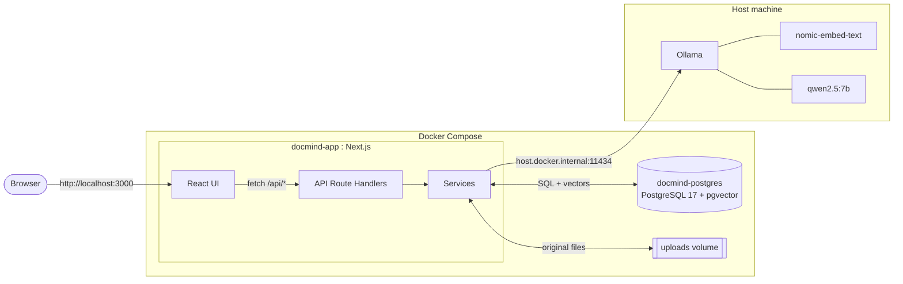
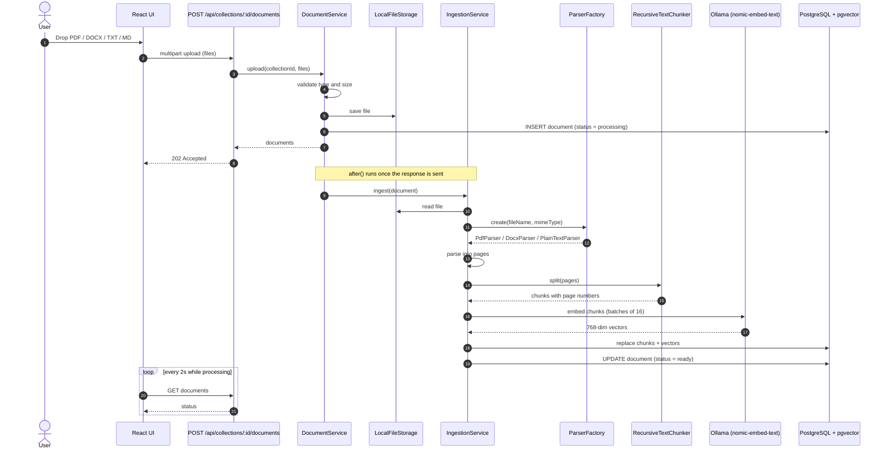
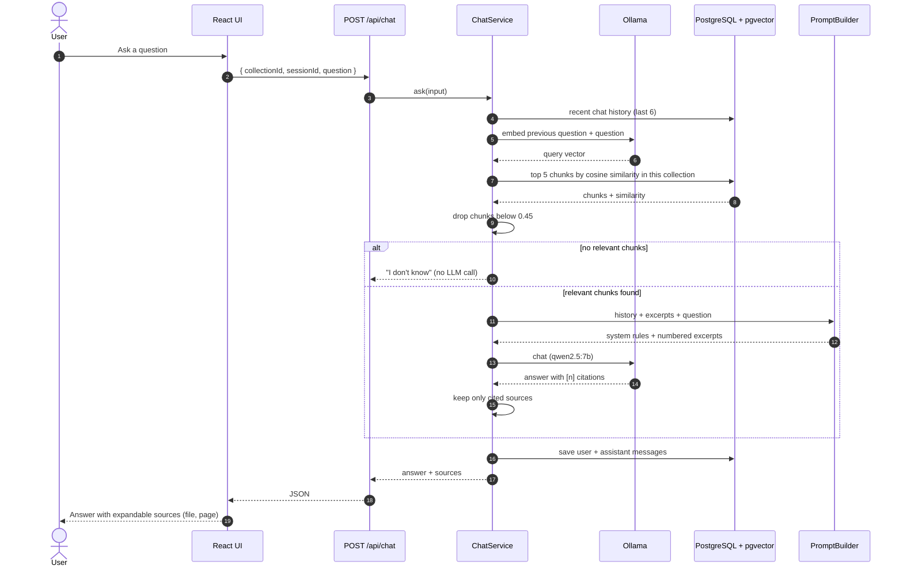
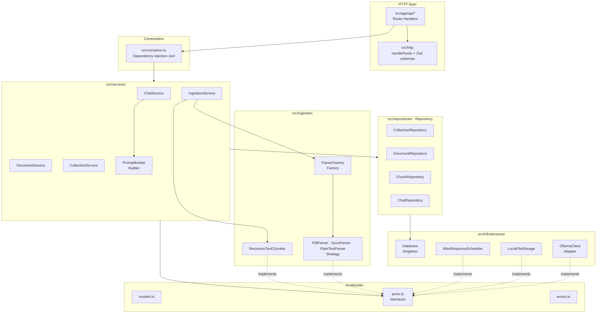
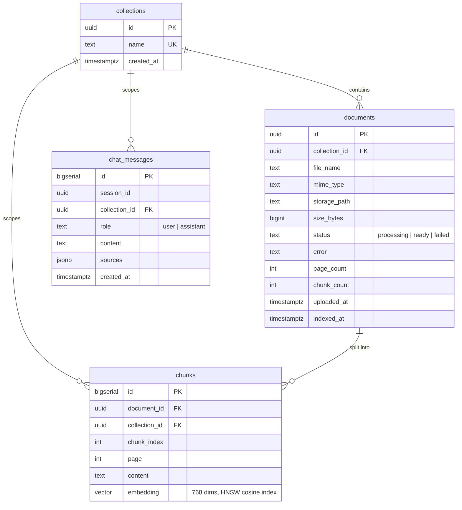
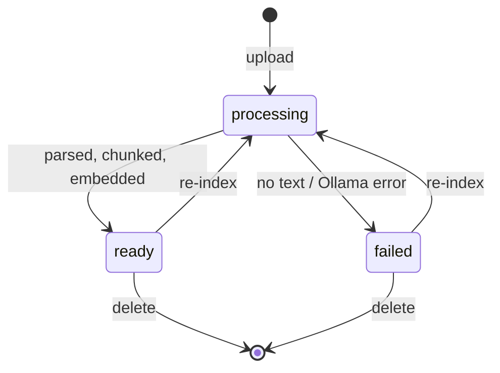

# AI Document Assistant Architecture

Diagrams of how the AI Document Assistant is put together and how data moves through it.

1. [System overview](#1-system-overview)
2. [Ingest flow](#2-ingest-flow)
3. [Chat flow](#3-chat-flow)
4. [Code layers](#4-code-layers)
5. [Database schema](#5-database-schema)
6. [Document lifecycle](#6-document-lifecycle)

---

## 1. System overview

What runs where. `docker compose up -d` starts the two containers; Ollama runs on the host so it can use the GPU.

---

## 2. Ingest flow

What happens after a file is uploaded. The upload returns right away; indexing runs in the background and the UI polls for the status.

---

## 3. Chat flow

How a question becomes a cited answer.

---

## 4. Code layers

Dependencies point inward. Services depend on interfaces in `domain/ports.ts`, and `container.ts` wires in the real implementations.

| Pattern | Where | Why |
|---|---|---|
| Strategy | `PdfParser`, `DocxParser`, `PlainTextParser` | Each file type has its own parser behind one interface |
| Factory | `ParserFactory` | Picks the right parser from the file name and MIME type |
| Repository | `src/repositories/*` | Keeps SQL out of the services |
| Singleton | `Database` | One shared connection pool |
| Adapter | `OllamaClient` | Wraps the Ollama HTTP API behind `EmbeddingProvider` and `ChatModel` |
| Builder | `PromptBuilder` | Assembles system rules, history, excerpts, and the question step by step |
| Dependency Injection | `container.ts` | Swap Ollama, storage, or the DB without touching services |

---

## 5. Database schema

Deleting a collection removes its documents, chunks, and chat messages (`ON DELETE CASCADE`).

---

## 6. Document lifecycle

